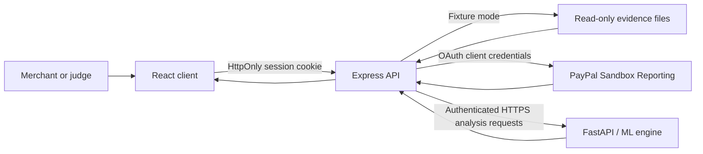

# LedgerLens Pro architecture

## Components

| Component | Responsibility | Boundary |
| --- | --- | --- |
| React/Vite client | Login/demo entry, dashboard, ledger, forecast, scenario controls, recurring/anomaly review, settings. | Session JWT is held in an HttpOnly cookie; never receives PayPal client secret or OAuth token. |
| Express API | Auth, evidence, dashboard, forecast, scenario, PayPal Reporting calls, analysis routing. | PayPal credentials and OAuth token remain server-side. Protected routes require JWT. |
| PayPal REST API | Sandbox Reporting balances and transaction search through OAuth 2.0 Client Credentials. | The deployed API and ML services are healthy. PayPal credentials have not been configured on the hosted API, so current hosted Reporting access is unverified. Previous local calls do not prove current hosted authorization. |
| FastAPI ML service | Seeded NumPy Monte Carlo endpoint, Isolation Forest anomaly endpoint, calibration metrics. | Analysis endpoints require a shared server-only key in production; outputs are estimates/signals, not facts or fraud decisions. |
| Evidence fixtures | Read-only CSV/JSON transactions, independent balance snapshot, model evidence, manifest. | Explicitly labeled `SANDBOX_EVIDENCE`; not a connected PayPal merchant account. |

## Data flow

## Trust and provenance rules

- Demo JWTs are marked `demo` and stored in HttpOnly cookies; API guards reject PayPal live-source requests for those sessions. Demo balances and movements come from fixture files only.
- State-changing browser requests are checked against the configured client origin. Production cookies are `Secure`, `HttpOnly`, and `SameSite=Lax`; Vercel proxies same-origin `/api/*` requests to Render to keep the session first-party. Logout clears the cookie, but JWT revocation and multi-tenant identity are not implemented.
- Configured PayPal credentials belong in the API server's ignored `.env` or a deployment secret manager. Never expose them through `VITE_*` variables, client responses, logs, screenshots, or Git history.
- PayPal Reporting values retain source and retrieval provenance. The evidence movement ledger and the PayPal balance snapshot remain separate; no snapshot is silently added to the ledger.
- The Render deployment calls the ML service over HTTPS and authenticates with a secret generated by its Blueprint environment group. The secret is shared only between API and ML services, never sent to the browser.
- Financial arithmetic in fixture reconciliation uses Decimal.js. Forecast values are simulation outputs, not ledger facts.
- Anomaly scores are investigation prompts. They do not confirm fraud or trigger automated action.
- API production use still needs durable persistence, tested ownership boundaries, webhook signature verification, and a real merchant authorization model.

## Local services

- Client: `http://localhost:3000`
- Express API: `http://localhost:4000/api`
- ML service: `http://localhost:8001`

`npm run dev:all` launches the three processes after Node and Python dependencies are installed.
